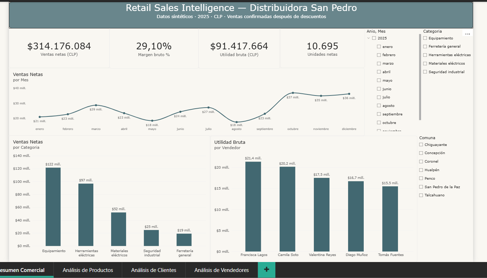
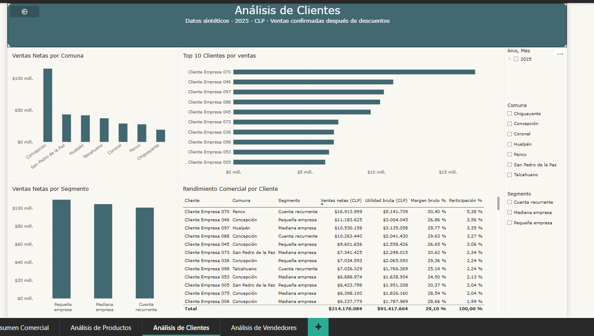

# Retail Sales Intelligence
### Ventas y rentabilidad para una distribuidora del Gran Concepción

Proyecto de portafolio en **Power BI · Power Query · DAX**, con 3.000 líneas de ventas sintéticas de 2025, moneda CLP y cuatro páginas de análisis.



## Del registro de ventas a una decisión comercial

Una distribuidora necesita entender cuánto vende, qué utilidad obtiene y dónde concentra su actividad. Este dashboard reúne esas preguntas en una vista comercial y permite explorar productos, clientes y vendedores.

| Pregunta | Página | Decisión que ayuda a evaluar |
|---|---|---|
| ¿Cómo evolucionan ventas y utilidad? | Resumen Comercial | Revisar meses de mayor y menor actividad |
| ¿Qué productos venden más y con qué margen? | Análisis de Productos | Revisar precios, descuentos y mezcla de productos |
| ¿Quiénes compran y dónde? | Análisis de Clientes | Priorizar seguimiento por cliente, comuna y segmento |
| ¿Cómo contribuye cada vendedor? | Análisis de Vendedores | Comparar ventas, utilidad y margen |

## Indicadores del caso

| Indicador | Resultado anual sin filtros |
|---|---:|
| Ventas netas | $314.176.084,32 |
| Costo de ventas | $222.758.420,00 |
| Utilidad bruta | $91.417.664,32 |
| Margen bruto | 29,10 % |
| Unidades netas | 10.695 |

Las ventas incluyen descuentos y solo líneas confirmadas. Las devoluciones confirmadas tienen cantidades negativas. Los importes visibles se redondean a pesos; los cálculos conservan su precisión interna.

El caso permite observar concentración comercial: Equipamiento lidera las ventas por categoría; Compresor 24L encabeza los productos; Francisca Lagos lidera ventas y utilidad entre vendedores. Son observaciones del conjunto sintético, no resultados de un cliente real ni evidencia de mejoras logradas.

## Vista de clientes



Las imágenes provienen de la entrega v2 abierta por el autor en Power BI Desktop. Las páginas de Productos y Vendedores también fueron mostradas en capturas durante la revisión; se omiten aquí porque esas capturas incluyen notificaciones superpuestas.

## Abrir y actualizar

1. Descarga el repositorio completo y extrae el ZIP, o clónalo.
2. Conserva juntas las carpetas `Data` y `PowerBI`.
3. Abre `PowerBI/Retail_Sales_Intelligence.pbip` en Power BI Desktop con soporte para PBIP/PBIR y TMDL.
4. En **Transformar datos → Administrar parámetros**, cambia `DataFolder` por la ruta absoluta de la carpeta `Data` descargada, sin barra final. Ejemplo: `C:\Proyectos\Retail-Sales-Intelligence\Data`.
5. Aplica los cambios y actualiza. Comprueba los indicadores anteriores sin filtros.

El parámetro tiene una ruta de ejemplo; debe configurarse antes de actualizar. Si Desktop no permite abrir la definición, conserva el mensaje exacto y la versión utilizada: no cambies versiones de esquema al azar.

## Modelo y habilidades

- Modelo estrella: FactVentas y dimensiones Producto, Cliente, Vendedor y Fecha.
- Power Query para importar y tipar las cinco hojas del Excel.
- DAX para ventas netas, costos, utilidad, márgenes, participaciones y rankings.
- Conciliación independiente de KPI y rankings con los datos fuente.
- Definiciones PBIP/PBIR y TMDL legibles para revisar cambios con Git.

## Validación y límites

La entrega v2 original abrió y mostró sus cuatro páginas según confirmación y capturas del autor. La revisión independiente concilió las 3.000 líneas y los rankings completos; no encontró claves dimensionales duplicadas ni ventas huérfanas. Esta copia introduce un parámetro de origen y necesita apertura y actualización propias antes de dar ese cambio por validado en Desktop. Consulta [validación de la entrega](docs/VALIDACION.md).

Las participaciones eliminan los filtros de toda su dimensión y conservan los de otras tablas; no siempre son porcentajes del subconjunto visible. Los KPI principales fuerzan el estado Confirmada. Hay 1.135 líneas con fecha de venta anterior al alta del cliente, anomalía documentada del conjunto sintético. No se declara tratamiento de IVA ni se simula stock disponible.

## Estructura

```text
Data/                       Excel sintético de origen
PowerBI/                    Proyecto editable, informe y modelo
docs/images/                Capturas de la demo
docs/historial/             Notas y validaciones de entregas anteriores
docs/VALIDACION.md           Alcance y comprobaciones pendientes
auditoria-metricas.json      Totales de referencia
Dim*-ranking.csv            Rankings de referencia
```

## Aplicación a una pyme

Este caso muestra cómo se puede organizar información comercial para revisar ventas y rentabilidad. Un trabajo con datos reales requiere acordar fuentes, calidad, definiciones de indicadores, frecuencia de actualización y acceso antes de construir el informe.

**Autor:** [Stormdead](https://github.com/Stormdead). Proyecto demostrativo con datos ficticios; no representa a una empresa real. Este repositorio contiene archivos y capturas: no es una demo web interactiva.
